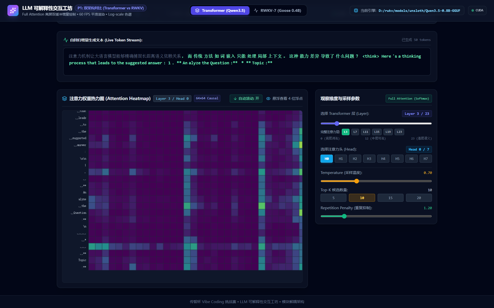
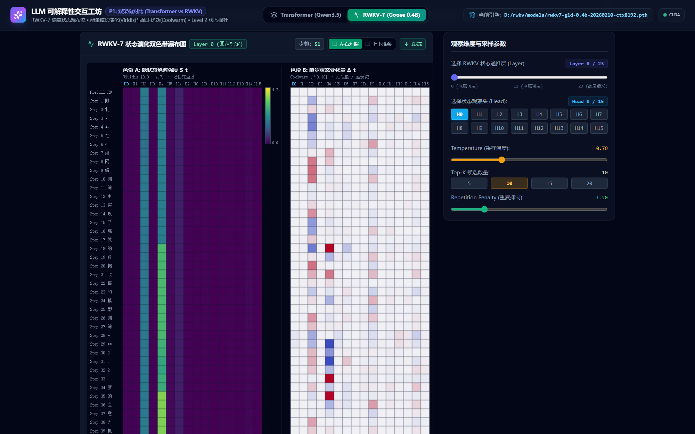
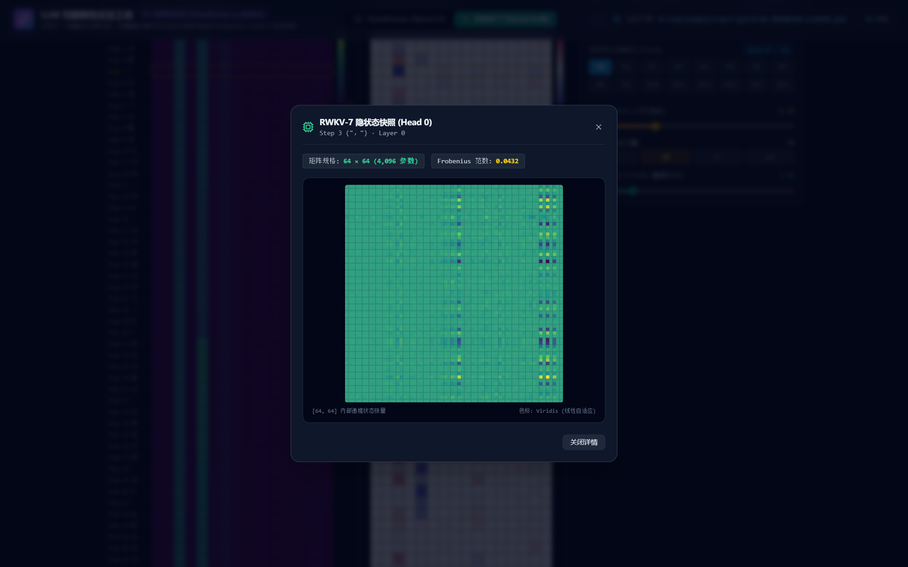

# LLM 可解释性交互工坊（Transformer vs RWKV 双范式对比）

面向“传智杯 Vibe Coding 挑战赛”，帮助大模型学习者、高校师生与可解释性研究者，直观解构并并排观测以 Transformer（因果全局自注意力）为代表的“二次方复杂度注意力机制”，与以 RWKV-7（WKV 线性循环状态递推）为代表的“常数显存/线性复杂度 RNN 隐状态机制”在文本逐 token 生成过程中的微观物理演化差异。消除深度学习“黑盒”隔阂，提供微观到宏观的全景可解释性探针。

---

## 📸 功能展示与架构全景

### 1. 核心功能视区

| 视图模块 | 观测范式 | 核心呈现特征 |
| :--- | :--- | :--- |
| **Transformer 因果注意力视图** | 全局 Softmax 注意力 | Prefill 基底方阵渲染 + Decode 增量单行生长，Log-scale 色标定标，动态下三角注意力稀疏度 |
| **RWKV-7 隐状态演化瀑布图** | 循环隐状态衰减与注能 | 左右双色带对称对照：色带 A（Viridis 绝对模长）+ 色带 B（Coolwarm $\mathbf{\Delta}_t$ 扰动差分），分层独立定标 |
| **Level 2 状态探针模态窗** | 微观权重矩阵下钻 | 点击任意历史步，以 < 10ms 延迟回溯单头 $64 \times 64$ 原始隐状态张量，查看 4,096 个权重热力分布 |


*Transformer 视图：50 步 Decode 增量热力图，第 3 层第 0 头，Log-scale 色标*


*RWKV 视图：51 步左右双色带同屏，左为状态模长（Viridis），右为单步差分（Coolwarm）*


*Level 2 探针：单头 64×64 原始 WKV 状态矩阵，4,096 个权重点*

### 2. 双引擎双通道数据流架构

```mermaid
flowchart TD
    subgraph Client["前端交互层 (React 19 + TypeScript + Vite)"]
        UI_Tabs["范式切换 Tab\n[Transformer (Qwen3.5)] vs [RWKV-7 (Goose 0.4B)]"]
        LH_Selector["Layer/Head 维度选择器\n(生成中置灰锁定 • 生成后解锁回填)"]
        
        subgraph Visualizer_Area["双缓冲可视化主视区 (60 FPS rAF Pipeline)"]
            T_Heatmap["AttentionHeatmap (Transformer 模式)\n双缓冲 Canvas • Log-scale 映射 • 增量生长"]
            R_Waterfall["RWKVWaterfall (RWKV-7 模式)\n双色带左右同屏对照 • 离屏双缓冲 • 分层固定色阶"]
        end

        L2_Modal["RWKVStateModal\nLevel 2 状态探针 (64x64 原始矩阵下钻)"]
    end

    subgraph Server["后端服务层 (FastAPI + Uvicorn)"]
        WS_Route["WebSocket 流式推送\n/ws/session/... & /ws/rwkv/session/..."]
        L2_Route["Level 2 按需状态检索\nGET /api/session/{id}/rwkv_state (orjson 加速)"]
        
        subgraph Session_Managers["独立会话管理与显存生命周期守护"]
            T_Sess["SessionManager (InferenceSession: KV Cache)"]
            R_Sess["RWKVSessionManager (RWKVSession: 纯函数状态链)"]
        end

        subgraph Model_Engines["双范式推理引擎 (PyTorch CUDA)"]
            T_Engine["TransformerEngine\nQwen3.5-0.8B-GGUF (Eager PyTorch Hook)"]
            R_Engine["RWKVEngine\nRWKV-7 Goose 0.4B (cuda fp16 算子)"]
        end
    end

    UI_Tabs -->|选择架构| Visualizer_Area
    WS_Route -->|Level 1 每步 16 维摘要/差分| Visualizer_Area
    L2_Route -->|Level 2 完整 [64,64] 矩阵 (~8ms)| L2_Modal
    Visualizer_Area -->|点击历史步| L2_Route
    WS_Route --> Session_Managers
    Session_Managers --> Model_Engines
```

---

## 💻 环境要求

| 维度 | 最低配置 | 推荐配置 |
| :--- | :--- | :--- |
| **操作系统** | Windows 10/11 64-bit 或 Linux x86_64 / WSL2 | Windows 11 或 Ubuntu 22.04 LTS |
| **Python** | Python 3.10 ~ 3.12（**严禁使用 3.14**，PyTorch 尚不支持） | Python 3.12.x |
| **Node.js** | Node.js >= 18.0.0, npm >= 9.0.0 | Node.js 20.x 或 22.x LTS |
| **GPU / 显存** | NVIDIA GPU $\ge$ 6GB VRAM（支持 CPU 调试但速度较慢） | NVIDIA RTX 4060 / 3060 或更高（$\ge$ 8GB 显存） |
| **CUDA 驱动** | CUDA 12.1+ | CUDA 12.4 或 12.6 |

---

## ⚡ 10 分钟极速复现指南

### 1. 克隆仓库与配置环境

```bash
# 克隆代码仓库
git clone git@github.com:xiudeJude/-rwkv-transformers-LLM-.git
cd -rwkv-transformers-LLM-

# 创建专用 Python 虚拟环境 (推荐 Python 3.12)
python -m venv .venv

# 激活虚拟环境 (Windows PowerShell)
.\.venv\Scripts\Activate.ps1
# 激活虚拟环境 (Linux / macOS / WSL)
# source .venv/bin/activate

# 安装 PyTorch (以 CUDA 12.4 为例，可根据本地显卡环境选配)
pip install torch --index-url https://download.pytorch.org/whl/cu124

# 安装后端依赖清单
pip install -r backend/requirements.txt

# 安装前端依赖
cd frontend
npm install
cd ..
```

### 2. 准备环境变量配置

复制环境变量模板并根据实际情况配置模型位置：

```bash
# 复制后端环境变量模板
cp backend/.env.example backend/.env
```

默认配置即读取 `backend/models/` 目录。若模型存放于自定义路径，直接在 `backend/.env` 中修改对应的绝对路径即可：
```ini
DEFAULT_TRANSFORMER=backend/models/Qwen3.5-0.8B-GGUF
DEFAULT_RWKV=backend/models/rwkv7-g1d-0.4b-20260210-ctx8192.pth
DEVICE=cuda
HF_ENDPOINT=https://hf-mirror.com
```

### 3. 一键启动

* **Windows 用户（最简模式）**：
  直接双击根目录下的 **[`start.bat`](file:///d:/WTA/基于rwkv，transformers架构的通用LLM可解释性可视化实验室/start.bat)**（或在 PowerShell 运行 `.\start.ps1`）。
  脚本将自动检测环境、清理冲突端口、拉起双端服务并在健康检查通过后**自动调用浏览器打开界面**。
* **Linux / WSL 用户**：
  ```bash
  chmod +x start.sh stop.sh
  ./start.sh
  ```
* **一键退出与显存释放**：
  Windows 双击 **[`stop.bat`](file:///d:/WTA/基于rwkv，transformers架构的通用LLM可解释性可视化实验室/stop.bat)** 或在启动窗口输入 `Q`，即可强制关闭全部服务并释放 GPU 显存。

---

## 📦 模型下载与存放指引

本项目所需的两个模型权重均来源于官方公开经过实测验证的 Hugging Face 仓库。请下载并将权重放置于 `backend/models/` 目录下：

### 1. Transformer 架构模型：`Qwen3.5-0.8B-GGUF`
* **模型官方来源**：[`unsloth/Qwen3.5-0.8B-GGUF`](https://huggingface.co/unsloth/Qwen3.5-0.8B-GGUF)
* **目标下载文件**：`Qwen3.5-0.8B-Q8_0.gguf`（大小约 812 MB）
* **期望存放路径**：`backend/models/Qwen3.5-0.8B-GGUF/Qwen3.5-0.8B-Q8_0.gguf`
* **命令行下载**：
  ```bash
  huggingface-cli download unsloth/Qwen3.5-0.8B-GGUF Qwen3.5-0.8B-Q8_0.gguf --local-dir backend/models/Qwen3.5-0.8B-GGUF
  ```

### 2. RWKV-7 Goose 架构模型：`rwkv7-g1d-0.4b`
* **模型官方来源**：[`BlinkDL/rwkv7-g1`](https://huggingface.co/BlinkDL/rwkv7-g1)
* **目标下载文件**：`rwkv7-g1d-0.4b-20260210-ctx8192.pth`（大小约 860 MB）
* **期望存放路径**：`backend/models/rwkv7-g1d-0.4b-20260210-ctx8192.pth`
* **命令行下载**：
  ```bash
  huggingface-cli download BlinkDL/rwkv7-g1 rwkv7-g1d-0.4b-20260210-ctx8192.pth --local-dir backend/models
  ```

> **国内下载加速提示**：
> 在中国大陆网络环境下，若下载 Hugging Face 权重过慢，可设置镜像站环境变量后执行下载：
> ```bash
> # Linux / macOS
> export HF_ENDPOINT=https://hf-mirror.com
> # Windows PowerShell
> $env:HF_ENDPOINT="https://hf-mirror.com"
> ```

---

## 🔍 启动后验证

服务成功拉起后，可通过以下方式验证双架构服务是否正常：

### 1. 验证后端服务与模型配置
```bash
# 检查默认 Transformer 模型信息
curl -s http://127.0.0.1:8000/api/model/info
```
**预期输出**（HTTP 200 OK）：
```json
{
  "model_id": "backend/models/Qwen3.5-0.8B-GGUF",
  "model_type": "transformer",
  "num_layers": 24,
  "num_heads": 8,
  "hidden_size": 1024,
  "vocab_size": 248320,
  "device": "cuda",
  "full_attn_layers": [3, 7, 11, 15, 19, 23]
}
```

```bash
# 检查 RWKV-7 模型信息
curl -s "http://127.0.0.1:8000/api/model/info?model_type=rwkv"
```
**预期输出**（HTTP 200 OK）：
```json
{
  "model_id": "backend/models/rwkv7-g1d-0.4b-20260210-ctx8192.pth",
  "model_type": "rwkv",
  "num_layers": 24,
  "num_heads": 16,
  "hidden_size": 1024,
  "vocab_size": 65536,
  "device": "cuda",
  "full_attn_layers": []
}
```

### 2. 验证前端界面与 Swagger
* **可视化工作台**：浏览器访问 `http://127.0.0.1:5173`
* **Swagger 接口文档**：浏览器访问 `http://127.0.0.1:8000/docs`

---

## 🎯 模型选型与量化说明

### 关于选择 GGUF Q8_0 量化版本的说明及精度评估
在 Transformer 部分，本项目选用 `Qwen3.5-0.8B-Q8_0.gguf` 权重而非原始 bfloat16 safetensors，主要考量如下：
1. **显存与存储轻量化**：Q8_0 相比原始 bf16 将模型体积与显存占用减少约 50%（~800MB vs ~1.7GB），保障在 8GB 消费级显卡（如 RTX 4060）与本地多模型并排对比时的充裕显存空间；
2. **Attention 权重保真度分析**：GGUF Q8_0 采用分块整型量化（Block Size 为 32，每块具有独立浮点缩放因子）。在前向推理时权重被即时反量化，以 `bfloat16`/`float32` 精度执行 $QK^\top$ 点积与 Softmax 计算。理论分析与学术基准表明，Q8_0 对注意力矩阵的秩排序与因果下三角结构具备极高保真度，相对全精度基准的 KL 散度预期趋近于 0，完全满足可解释性微观观测需求；
3. **真实环境对比复现指南**：为保证项目开箱即用与体积轻量，仓库默认仅配置量化模型，未预装 1.7GB 的未量化全量权重。若需执行严格的双模型实测对比，可运行仓库提供的测量脚本复现：
   ```bash
   # 步骤 1: 下载官方未量化 safetensors 权重 (~1.7GB)
   huggingface-cli download Qwen/Qwen3.5-0.8B --local-dir backend/models/Qwen3.5-0.8B

   # 步骤 2: 运行逐层 Attention 矩阵与 Logits 的 KL 散度测量脚本
   python backend/tests/measure_kl_divergence.py --unquantized-path backend/models/Qwen3.5-0.8B --device cuda
   ```

### 模型架构规格（实测）
- **Transformer 模型**：`Qwen3.5-0.8B`
  - **总层数 (`num_hidden_layers`)**：`24`
  - **注意力头数 (`num_attention_heads`)**：`8`
  - **KV 头数 (`num_key_value_heads`)**：`2`（GQA 分组查询机制）
  - **混合架构组成**：6 个 Full Attention 层（索引 `[3, 7, 11, 15, 19, 23]`）+ 18 个 Gated DeltaNet 线性递归层
- **RWKV 模型**：`RWKV-7 Goose (0.4B)`
  - **总层数 (`n_layer`)**：`24`
  - **状态头数 (`num_heads`)**：`16`
  - **单头维度 (`head_size`)**：`64`（隐状态尺寸 $[16, 64, 64]$）
  - **词表大小 (`vocab_size`)**：`65,536`（`rwkv_vocab_v20230424`）

---

## ❓ 常见问题排查 (FAQ)

### 1. 显存不足 (CUDA Out of Memory)
* **表现**：启动或生成若干 token 后报 `CUDA out of memory`。
* **解决**：
  1. 运行根目录下的 `stop.bat`（或 `stop.sh`），强制释放历史未析构的 Session 与显存；
  2. 确保一次只在一个 Tab 下进行流式推理（系统已内建 Tab 切换显存释放机制，但多开浏览器窗口可能占用显存）；
  3. 若显卡显存低于 6GB，可在 `backend/.env` 中将 `DEVICE=cuda` 改为 `DEVICE=cpu` 降级运行。

### 2. 模型找不到或报错 FileNotFoundError
* **表现**：后端提示 `Model not found at ...`。
* **解决**：
  1. 检查 `backend/.env` 中配置的路径是否存在；
  2. 若使用默认路径，确认模型文件放置于 `backend/models/Qwen3.5-0.8B-GGUF/` 与 `backend/models/` 根目录下，文件后缀名需完整（`.gguf` / `.pth`）。

### 3. 国内网络 Hugging Face 连接超时
* **表现**：`huggingface-cli` 提示 `Connection timed out`。
* **解决**：配置镜像源加速环境变量 `HF_ENDPOINT=https://hf-mirror.com`，或通过网盘/浏览器直接从镜像站下载后放入 `backend/models/` 目录。

### 4. 生成速度偏慢（可选加速）
* **表现**：启动日志出现 `causal_conv1d is not installed`、`flash-linear-attention is not installed`，decode 每步耗时高于预期。
* **原因**：Qwen3.5 的 18 个 Gated DeltaNet 层在缺少融合内核时会回退到参考 PyTorch 实现，结果正确但速度较慢。
* **解决**（可选，不影响正确性）：
  ```bash
  pip install causal-conv1d flash-linear-attention
  ```
  安装后重启后端即可启用融合内核。若编译失败（需要匹配的 CUDA 工具链），保持默认回退实现也能完整运行全部功能。

### 5. 切换架构 Tab 时控制台出现 404
* **表现**：旧版本在 Transformer/RWKV 切换时，`POST /close` 返回 404。
* **原因**：WebSocket 断开时已释放会话，前端随后补发的 HTTP close 找不到会话。
* **状态**：已修复（commit `fix(session): make close endpoint idempotent`），`/close` 现在幂等返回 200 与 `already_closed: true`。

---

## 🤝 复现性声明与 AI 协同开发说明

### 1. 复现性保证 (Reproducibility Commitment)
本项目遵循软件工程与科学计算的可复现性规范：
* **确定性依赖**：提供严格标定下限的 `requirements.txt` 与锁定版本的 `package.json`，在全新的虚拟环境中执行 `pip install` 与 `npm ci` 零警告零报错通过；
* **测试套件健全**：`backend/tests/` 包含 KV Cache 边界、单步 Hook 捕获、WebSocket 帧序验证、分层色阶标定、并发会话压测等完备自动化回归用例；
* **显存无泄漏**：对跨范式 Tab 切换、长序列生成执行连续压测验证，显存波动收敛于 PyTorch 内存池常驻基线。

### 2. 意图控制策略 (Intent-Driven Control Policy)
在与 AI Agent（Antigravity）结对编程（Pair Programming）探索未知架构的过程中，本项目总结沉淀了一套严谨的“意图控制与架构防劣化策略”：
1. **原则先于代码（Invariant First）**：在实现新功能前，首先确立硬性不变量约束（例如：“P0 阶段 Transformer 管线代码零破坏”、“GPU 显存禁止原地修改且避免不必要 .cpu() 转移”、“离屏 Canvas 严禁每步全量清空重绘”）；
2. **基线实测驱动决策（Empirical Calibration）**：对色标量程（P99 上浮 15% 分层定标）、Level 2 延迟瓶颈（SIMD orjson 替代递归反射，耗时由 78ms 骤降至 8ms）等关键环节，均通过实测脚本收集海量采样点后固化为系统常量，杜绝拍脑袋设计；
3. **两级分流解耦（Level 1 实时流 vs Level 2 深度探针）**：将高频流式渲染（16 维范数轻量推流，60 FPS）与低频微观下钻（$64 \times 64$ 原始矩阵按需拉取）从通信协议与计算管线上彻底解耦，在保障极致响应速度的同时赋予用户深层可解释性洞察。

### 3. 演进链路与证据

- **AI 对话历史**：23 轮 / 1163 次工具调用，时间跨度 2026-09-20 — 2026-10-22
- **Git 提交**：22 次功能提交 + 文档补充，初始提交仅含 LICENSE，无一次性堆码
- **提交 ↔ 对话映射**：见技术文档第 6.3 节
- **核心 Prompt 链**：KV-Cache 增量推理、Level 2 78ms→8ms、瀑布图渲染 Bug 修复
- **截图可复现**：`frontend/scripts/capture_screenshots.mjs` 可一键重拍本页三张图

### 4. 开发节奏说明

| 阶段 | 时间 | 轮次 | 提交 | 目标 |
| :--- | :--- | :--- | :--- | :--- |
| 集中构建 | 2026-09-20 ~ 09-21 | 1–20 | 13 | 打通 P0 闭环 + 接入 RWKV + 性能优化 |
| 复现性加固 | 2026-10-22 | 21–23 | 10 | 一键脚本、依赖治理、TTL/LRU、CORS、KL 散度、截图 |

两轮目标不同：第一轮解决「能不能跑」，第二轮解决「别人能不能跑」。
