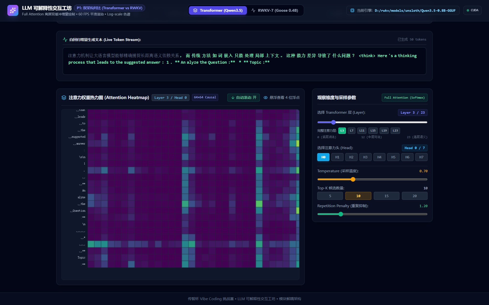
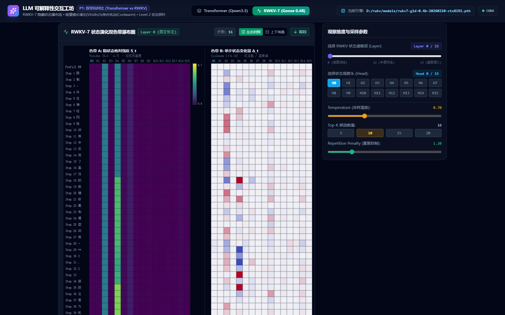
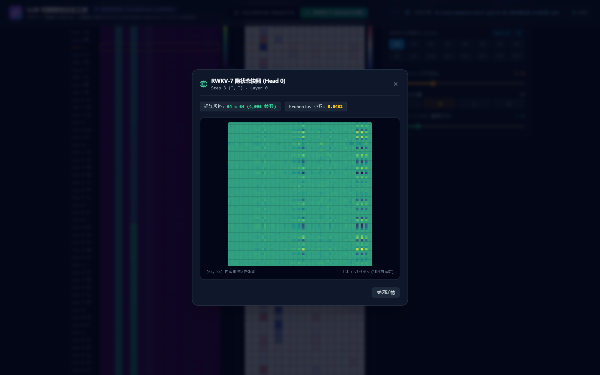
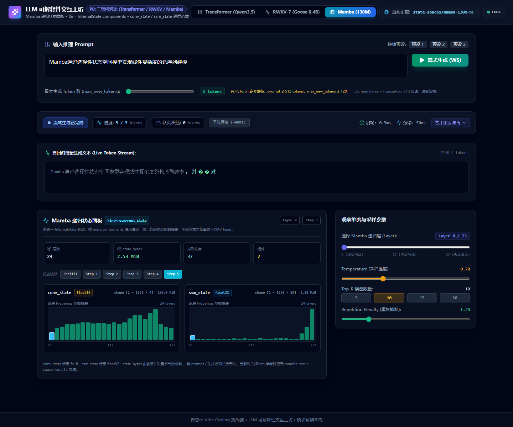
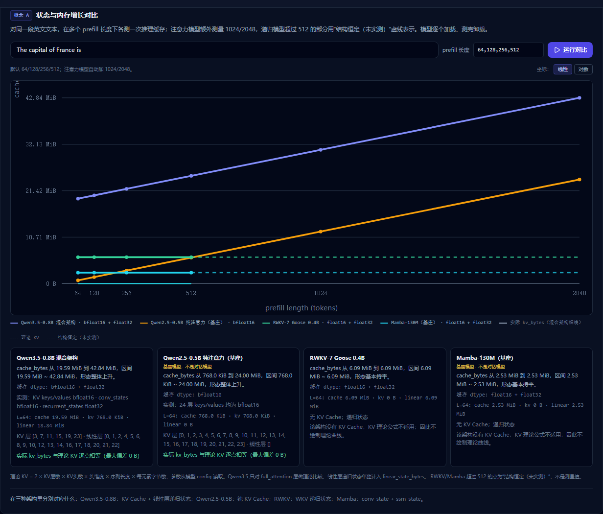

# 基于 RWKV / Transformers / Mamba 架构的通用 LLM 可解释性可视化实验室

## 技术文档

| 项 | 内容 |
|---|---|
| 赛事 | 全国高校 Vibe Coding 开发挑战赛 |
| 组别 | B 组 |
| 作品形态 | Web 端交互式可解释性工具（前后端分离，本地部署） |
| 仓库 | https://github.com/xiudeJude/-rwkv-transformers-LLM- |
| 版本 | v1.1.0（2026-11-10） |
| 文档版本 | 2.0 |

---

## 目录

| 章节 | 内容 |
|---|---|
| 1 | 项目概述 |
| 2 | 系统总览与架构设计 |
| 3 | 核心实现 |
| 4 | 意图控制策略 |
| 5 | 工程质量与实测数据 |
| 6 | 可复现性论证 |
| 7 | 开发演进链路 |
| 8 | 局限与展望 |
| 附录 A | 接口清单 |
| 附录 B | 文档与证据索引 |

---

## 1. 项目概述

### 1.1 问题背景

大语言模型的可解释性长期停留在"论文图表"与"离线脚本"层面。学习者想观察内部机制，通常只有三条路径：读论文里的静态图、写一次性脚本把 attention 存成图片、或用封装过深的可视化平台。三者共同的缺陷是：**观测对象是"结果"，不是"过程"**。

而 LLM 生成是一个逐 token 的动力学过程——注意力如何在解码步之间重新分配、循环状态如何被写入与遗忘，恰恰是最有解释价值的部分。

2025 年以来，架构层面出现明显分化：

- **Transformer**：因果全局自注意力，计算与显存随序列长度二次增长；
- **RWKV-7**：WKV 线性循环状态递推，显存恒定、计算线性；
- **Mamba**：选择性状态空间模型（SSM），同样是常数显存，但状态由卷积状态与 SSM 状态两部分组成。

三类架构对"上下文"的处理哲学完全不同，却很少有工具能在**同一输入、同一界面、同一时间轴**上并排观测它们的内部演化。

### 1.2 作品定位与本次升级

项目第一版（2026-09）只覆盖 Transformer 与 RWKV 两条链路。省赛评审反馈指出：

> 产品只能解释 Transformer，希望更通用、能解释更多概念。

v1.1 针对这条反馈做了两件事，而不是简单堆功能：

1. **架构通用化**：抽出统一的 `ModelAdapter` 抽象层，把 Transformer / RWKV / Mamba 三套完全不同的推理链路收敛到同一组接口、同一套会话管理、同一套 REST/WebSocket 协议、同一套前端状态渲染。新增第四种模型只需实现 9 个方法，不需要再写一套 Session 或新接口。
2. **概念通用化**：新增"概念实验室"，把可解释性从"看某一个模型的某一层"提升到"跨模型比较同一类机制"——内存增长曲线、分词差异、采样如何改变概率分布。

当前提供四个视图：

| 视图 | 观测对象 | 交互方式 |
|---|---|---|
| Transformer 注意力视图 | 每层每头 `[L, L]` 注意力权重 | 层/头选择、Log 色标、历史步回填 |
| RWKV-7 隐状态瀑布图 | 每层 16 个 head 的 WKV 模长 `S_t` 与差分 `Δ_t` | 左右双色带同屏、层切换、历史回溯 |
| Mamba 状态面板 | `conv_state` / `ssm_state` 的 shape、dtype、字节数与逐层范数 | 组件切换、层级范数对比 |
| 概念实验室 | 跨模型的内存、分词、采样三组对照 | 参数调节、实时重算、线性/对数坐标切换 |

### 1.3 核心创新点

1. **一套抽象覆盖三类架构**：`ModelAdapter` 把"模型生命周期 + 分词 + prefill + step + 状态导出"收敛为统一契约，三类引擎的差异被封装在适配器内部，调用方完全不感知。
2. **统一内部状态 `InternalState`**：用 `kind` 区分"注意力"与"递归状态"，前端只依赖这一个结构，不再为每个模型写一套渲染分支。
3. **缓存字节可拆解**：`cache_bytes = kv_bytes + linear_state_bytes`，理论 KV 曲线只与实际 `kv_bytes` 比较，避免把线性层递归状态混进 KV 理论值。
4. **两级数据分流**：Level 1 每步只推 16 维摘要（保证 60 FPS），Level 2 按需拉取完整矩阵（保证深度）。
5. **增量渲染**：离屏 Canvas 逐行追加 + rAF 自适应节流（40 ms / 15 ms 双档），51 步长序列无断层。
6. **显存全生命周期治理**：会话 TTL（1800 s）+ LRU 上限（10）+ Tab 切换强制析构 + `sendBeacon` 兜底，10 次高频切换显存漂移从 +664 MB 压到 +59 MB。
7. **并发门控**：`ModelGate` 用非阻塞锁保证同一时刻只有一个模型在跑重计算，冲突时返回 409 而不是排队卡死或 OOM。

### 1.4 界面实拍

以下截图均为本地实机运行（RTX 4060 8GB）。



*图 1-1　Transformer 视图：50 步 Decode 增量热力图，第 3 层第 0 头*



*图 1-2　RWKV 视图：51 步左右双色带，左为状态模长（Viridis），右为单步差分（Coolwarm）*



*图 1-3　Level 2 探针：单头 64×64 原始 WKV 状态矩阵*



*图 1-4　Mamba 视图：`conv_state` 与 `ssm_state` 的形状、dtype、字节数与逐层范数*



*图 1-5　概念 A：四个模型的缓存字节随序列长度变化，含理论 KV 曲线与交叉点标注*

---

## 2. 系统总览与架构设计

### 2.1 技术栈

| 层 | 选型 | 版本约束 |
|---|---|---|
| 前端框架 | React + TypeScript + Vite | React 19 / Vite 8 / TS 6 |
| 样式 | Tailwind CSS | 3.4 |
| 可视化 | 原生 Canvas 2D + OffscreenCanvas + SVG | 无第三方图表库 |
| 后端框架 | FastAPI + Uvicorn | FastAPI ≥ 0.115 |
| 实时通信 | WebSocket + HTTP | — |
| 推理 | PyTorch + Transformers + rwkv 官方包 | torch ≥ 2.2 |
| 序列化 | orjson（Rust 实现） | ≥ 3.10 |
| 模型 | Qwen3.5-0.8B / RWKV-7 Goose 0.4B / Mamba-130M / Qwen2.5-0.5B | — |

前端刻意不引入 ECharts / D3：数据更新频率是"每 token 一次"，51 步时单帧要处理 16×51 个色块，通用图表库的虚拟 DOM / SVG 开销会直接吃掉帧预算。

### 2.2 分层架构

```
┌─────────────────────────────────────────────────────────────┐
│  API 层  FastAPI                                            │
│  REST: /api/session/*  /api/rwkv/session/*  /api/concept/*  │
│  WS  : /ws/session/{id}/stream   /ws/rwkv/session/{id}/stream│
├─────────────────────────────────────────────────────────────┤
│  会话层                                                      │
│  InferenceSession（通用包装器：id / 时间戳 / TTL / LRU）      │
│  SessionManager / RWKVSessionManager（兼容子类）             │
│  ModelGate（非阻塞并发锁，冲突返回 409）                      │
├─────────────────────────────────────────────────────────────┤
│  适配层  ModelAdapter（抽象基类）                             │
│  ├─ TransformerAdapter        transformer                   │
│  ├─ PureAttentionAdapter      attention_baseline            │
│  ├─ RWKVAdapter               rwkv                          │
│  └─ MambaAdapter              mamba                         │
│  AdapterRegistry：模型类型名 → 适配器类                       │
├─────────────────────────────────────────────────────────────┤
│  推理层                                                      │
│  Qwen3.5（6 层 Full Attention + 18 层 Gated DeltaNet）        │
│  RWKV-7（WKV 状态 [16, 64, 64]）                             │
│  Mamba-130M（conv_state + ssm_state）                        │
│  Qwen2.5-0.5B（纯注意力对照，仅概念实验室）                   │
└─────────────────────────────────────────────────────────────┘
```

### 2.3 统一内部状态 InternalState

所有适配器导出的状态都使用同一个结构，由 `kind` 区分类型：

| 字段 | 类型 | 含义 |
|---|---|---|
| `kind` | str | `"attention"` 或 `"recurrent_state"` |
| `model_type` | str | 注册名，如 `transformer` / `rwkv` / `mamba` |
| `layer` / `head` | int / int? | 目标层与目标头 |
| `seq_len` / `step` | int | 当前序列长度；0 表示 prefill |
| `cache_bytes` | int | 推理必需的缓存字节（KV / 递归 / Mamba 状态） |
| `viz_history_bytes` | int | 仅为可视化额外保存的历史字节 |
| `state_bytes` | int | 兼容字段，等于前两者之和 |
| `matrix` / `row` | Any? / float[]? | 注意力矩阵或递归状态矩阵；Level 1 可为 null |
| `summary` / `delta` | float[]? | 各头状态摘要与单步变化 |
| `meta` | dict | 模型相关补充信息（如 Mamba 的 components） |

这套结构让前端只写一次渲染分支：`kind="attention"` 走热力图，`kind="recurrent_state"` 走状态面板，模型名称只影响文案。

### 2.4 三类架构的数据流

**Transformer**

```
prompt ──tokenize──▶ input_ids[1,L]
        ├─ prefill: model(use_cache=True, output_attentions=True)
        │            ├─ past_key_values (DynamicCache)
        │            └─ attentions: 6 × [1, 8, L, L]（仅全注意力层）
        └─ decode loop: input_ids[1,1] + past_key_values
             ├─ 新 cache（原地替换）
             ├─ attention_slice: [1, 8, 1, L+t]
             └─ logits ──sample──▶ token
```

**RWKV-7**

```
prompt ──encode──▶ token_ids[L]
        ├─ prefill: model.forward(tokens, state=None)
        │            └─ state: List[Tensor]，长度 = 3 × n_layer
        │               wkv_state 位于 layer*3+1，shape [16, 64, 64]
        └─ decode: model.forward([token], state)
             ├─ 新 state（纯函数，不原地修改）
             ├─ 逐头 Frobenius 范数 → 16 维摘要
             └─ Δ_t = S_t − S_{t−1}
```

**Mamba**

```
prompt ──tokenize──▶ input_ids[1,L]
        ├─ prefill: model(input_ids, use_cache=True)
        │            └─ cache 逐层包含：
        │               conv_state  [1, 1536, 4]  fp16
        │               ssm_state   [1, 1536, 16] fp32
        └─ decode: 新 cache，字节数与序列长度无关
```

Mamba 没有注意力头，`num_heads=0`、`head=None`、`matrix=None`，不伪造热力图。

---

## 3. 核心实现

### 3.1 统一模型适配层

`ModelAdapter` 定义在 `backend/app/models/adapter_base.py`，共 9 个必须实现的方法：

```python
# 生命周期
load_model(model_name_or_path, device=None)
unload()
is_loaded() -> bool
get_metadata() -> ModelMetadata

# 分词
tokenize(text) -> dict
decode_token(token_id) -> str
detokenize(token_ids) -> str

# 生成
create_state() -> Any
prefill(state, prompt, target_layer=0, target_head=0) -> dict
step(state, temperature=0.7, top_k=10,
     repetition_penalty=1.2, target_layer=0, target_head=0) -> dict

# 状态导出
export_state(state, step=None, layer=0, head=None,
             include_matrix=True) -> InternalState
cache_metrics(state) -> dict
close_state(state) -> None
```

关键设计：

- `state` 是适配器私有的不透明对象。Transformer 里是 KV Cache + 注意力历史，RWKV 里是逐层 WKV 状态，Mamba 里是 conv/ssm 状态。调用方不需要知道内部结构。
- `InferenceSession` 只负责会话 id、时间戳与 TTL/LRU 所需的访问时间，把 `prefill/step/export_state` 转发给适配器。
- `/api/model/info` 默认引擎、Transformer / RWKV / Mamba 路由分别通过 `create_adapter(settings.MODEL_TYPE)` 等获取适配器，不硬编码类名。
- 旧类名 `TransformerEngine` / `RWKVEngine` 保留为别名，现有脚本与测试不需要改动。

### 3.2 Transformer：混合注意力与 KV Cache

Qwen3.5-0.8B 不是纯 Transformer。24 层里 6 层是标准全注意力（`[3, 7, 11, 15, 19, 23]`），其余 18 层是 Gated DeltaNet 线性递归层。因此：

- `outputs.attentions` 只包含 6 个张量，不是 24 个；
- 前端选择"第 3 层"时必须做一次映射，否则选第 0 层会拿到第 3 层的矩阵却不自知。

层号不写死，从 `config.layer_types` 生成：

```python
full_layers = [i for i, t in enumerate(config.layer_types) if t == "full_attention"]
```

缓存拆分同样按这些层号遍历实际缓存对象：全注意力层的 `keys/values` 计入 `kv_bytes`，线性层的 `conv_states` / `recurrent_states` 计入 `linear_state_bytes`。

**KV Cache 增量推理**的三个边界（第 5 轮 Prompt 明确要求，全部实测通过）：

| 验证项 | 方法 | 结果 |
|---|---|---|
| 增量切片形状 | 连续 10 步记录长度 | 严格 `L+t` 递增 |
| 显存不随步数增长 | 每步 `memory_allocated()` | 基线 ±30 MB |
| 会话隔离 | 两个 session 同 prompt、temperature=0 | token 序列完全一致 |

### 3.3 RWKV-7：WKV 状态提取

RWKV 的记忆是 `[16, 64, 64]` 的 WKV 状态矩阵。直接推给前端不现实（单层 65,536 个浮点数），项目用 Frobenius 范数把每个 head 压缩成一个标量：

```python
wkv_state = state[layer * 3 + 1]              # [16, 64, 64]
head_norms = torch.norm(wkv_state, p='fro', dim=(-2, -1))
summary = [round(float(v), 6) for v in head_norms.tolist()]
delta = [s_t - s_prev for s_t, s_prev in zip(summary, prev_summary)]
```

为什么用 Frobenius 范数而不是均值/最大值：范数对矩阵整体能量变化敏感，且与 head 维度无关，16 个 head 之间可直接比较；均值在状态稀疏时区分度很差。

**分层独立定标**：不同层的状态模长量级差异很大，共用色标会让浅层全部挤在色带底部。项目对每层单独计算 `max_norm`，切换层时重算。

### 3.4 Mamba：递归状态映射

Mamba 验证了 `kind="recurrent_state"` 抽象不只适用于 RWKV。它的状态形状与 RWKV 完全不同：

| 组件 | 形状 | dtype | 含义 |
|---|---|---|---|
| `conv_state` | `[1, 1536, 4]` | float16 | 卷积窗口状态 |
| `ssm_state` | `[1, 1536, 16]` | float32 | SSM 隐状态 |

适配器把这些状态放进 `InternalState.meta["components"]`，每个组件包含 `name`、`shape`、`dtype`、`bytes`、`layer_norms`（逐层范数摘要）。前端 `MambaStatePanel` 只读 `kind` 与 `meta.components`，按组件通用渲染，不写死层数、shape 或 dtype。

`state_bytes` 是各组件字节数之和，与 prompt 长度、已生成 token 数无关——这正是常数显存架构的核心特征。

限制：`mamba-130m-hf` 是基座模型不是对话模型；未安装 `mamba-ssm` / `causal-conv1d` 时 Transformers 回退到 PyTorch 参考实现，因此路由限制 prompt ≤ 512 tokens、单次生成 ≤ 128 tokens。

### 3.5 概念实验室

三个实验都遵循"一次只加载一个模型、测完立即卸载"的原则，避免在 8 GB 显存上同时驻留四个模型。

**概念 A：状态与内存增长**

在 64 / 128 / 256 / 512（Transformer 类额外 1024 / 2048）长度上各做一次 prefill，记录 `cache_bytes` / `kv_bytes` / `linear_state_bytes` / dtype。四个模型使用同一组 token id，长度不足时循环重复已有 token 而非 pad 填充。

实测（2026-11-10，RTX 4060，transformers 5.17.0，单位 B）：

| 模型 | 64 | 512 | 2048 | 斜率 |
|---|---:|---:|---:|---|
| Qwen3.5-0.8B（混合） | 20,545,536 | 26,050,560 | 44,924,928 | 12,288 B/token（仅 KV） |
| Qwen2.5-0.5B（纯注意力） | 786,432 | 6,291,456 | 25,165,824 | 12,288 B/token |
| RWKV-7 0.4B | 6,389,760 | 6,389,760 | 未实测 | 0（恒定） |
| Mamba-130M | 2,654,208 | 2,654,208 | 未实测 | 0（恒定） |

两个交叉点：
- Mamba 常数 2,654,208 ÷ 12,288 ≈ **216 token**
- RWKV 常数 6,389,760 ÷ 12,288 ≈ **520 token**

理论 KV 曲线只与实际 `kv_bytes` 比较（不是混合架构的总 `cache_bytes`），当前两个注意力模型均为**逐点相等，最大偏差 0 B**。

**概念 B：分词对比**

只加载 tokenizer，不加载权重。Transformer 用 Qwen tokenizer（GGUF 目录通过 `gguf_file` 显式解析），RWKV 用官方 TRIE tokenizer，Mamba 用 GPTNeoX tokenizer。每个 token 返回文本、id、UTF-8 字节数，前端用彩色 token 块并排展示。

**概念 C：采样如何改变概率分布**

后端返回该步原始 top-50 logits，前端在浏览器本地计算 softmax / Temperature / Top-K / Top-P / 重复惩罚的组合结果。`backend/app/services/sampling.py` 是与前端公式对应的参考实现，`frontend/scripts/crosscheck_sampling.mjs` 用 11 组 fixture 逐值比较，容差 `1e-6`。

### 3.6 两级分流协议

**Level 1（流式）**：WebSocket 每步推送 16 维摘要 + 单行注意力切片，单步 payload 仅数百字节。

**Level 2（按需）**：用户点击历史步或切换层/头时才拉取完整 `[64, 64]` 或 `[L, L]` 矩阵。

Level 2 首版耗时 78 ms，逐阶段基准测试定位到根因不在显存拷贝：

| 阶段 | 耗时 | 占比 |
|---|---|---|
| `detach().float().cpu()` 显存→主机 | 1.8 ms | 2% |
| Python 三重循环 + 65,536 次 `round()` | 21.5 ms | 28% |
| FastAPI `jsonable_encoder` 递归检查 | 29.1 ms | 37% |
| 标准库 `json.dumps` | 25.5 ms | 33% |

优化：`tensor.tolist()` 替代 Python 循环、`orjson.dumps()` + `Response` 绕过递归编码、增加可选 `head` 参数。

优化后实测（同一 session 连续 5 次）：

| 调用 | 全量 16 头 | 单头 |
|---|---|---|
| 1 | 29.01 ms | 11.13 ms |
| 2 | 22.11 ms | 9.04 ms |
| 3 | 24.53 ms | 7.99 ms |
| 4 | 25.21 ms | 9.37 ms |
| 5 | 22.96 ms | 7.95 ms |

### 3.7 前端渲染管线

`SmoothRenderPipeline` 是一个 rAF 驱动的消费队列：

```ts
push(item) { this.queue.push({ item, arrivedAt: performance.now() }); }

rafLoop = (ts) => {
  const backlog = this.queue.length;
  const interval = backlog > 5 ? 15 : 40;      // 自适应双档
  if (ts - this.lastRenderTime >= interval && this.queue.length) {
    const entry = this.queue.shift()!;
    this.callbacks.onRenderToken(entry.item, metric);
  }
  requestAnimationFrame(this.rafLoop);
};
```

三个设计点：

1. **onmessage 只入队，不绘制**。WebSocket 到达间隔不均匀，直接绘制会抖动。
2. **双档节流**。正常 40 ms，积压超过 5 条切 15 ms 追赶，追平后回落。
3. **时序指标采集**。每条消息记录 `arrivalDeltaMs` / `renderDeltaMs` / `queueBacklog`，前端可直接展示"网络到达间隔 vs 实际渲染间隔"。

Canvas 侧采用双缓冲：离屏 `OffscreenCanvas` 保存历史行，每来一个 token 只在底部追加 1 行；可见 Canvas 每帧只做一次 `drawImage`；层/头切换时才全量重绘。

### 3.8 并发门控与显存治理

`ModelGate` 用非阻塞锁保证同一时刻只有一个模型在跑重计算：

```python
class ModelBusyError(RuntimeError): ...

class ModelGate:
    def __init__(self):
        self._lock = threading.Lock()

    def hold(self):
        if not self._lock.acquire(blocking=False):
            raise ModelBusyError("模型正忙，请稍后重试")
        try:
            yield
        finally:
            self._lock.release()
```

冲突时返回 409，前端提示"模型正忙"，而不是排队卡死或并发 OOM。

三层显存防护：

1. **会话级**：`SESSION_TTL_SECONDS=1800` 回收 + `MAX_SESSIONS=10` LRU 淘汰。
2. **操作级**：切换架构 Tab 时 `closeActiveSession()` 依次执行 WS `close` → HTTP `/close` → 组件卸载 `sendBeacon` 兜底。
3. **进程级**：`stop.bat` / `stop.sh` 强制结束服务，释放全部显存。

实测（10 次高频切换）：

| 阶段 | 起始 | 10 次后 | 净增 |
|---|---|---|---|
| 治理前 | 7104 MB | 7768 MB | +664 MB（濒临 OOM） |
| 治理后 | 7040 MB | 6948 MB | +59 MB（内存池正常抖动） |

---

## 4. 意图控制策略

整个项目分两个阶段完成，共 36 轮对话、约 2350 次工具调用、80 条提交。两阶段的控制方法一致，但目标不同。

### 4.1 四层约束模型

| 层级 | 约束对象 | 手段 | 示例 |
|---|---|---|---|
| L1 不变量 | 不可破坏的技术前提 | 写进 Prompt 的硬性要求 | `attn_implementation="eager"` 禁止替换 |
| L2 接口契约 | 模块间的数据形状 | 先定 schema 再写实现 | `attention_slice` 必须是 `[B,H,1,L+t]` |
| L3 验收标准 | 什么算"完成" | 可执行验证脚本 | 连续 10 步形状递增 + 显存不增长 |
| L4 节奏 | 一次改多少 | 小步确认 + 单次提交 | 每轮只做一个模块，跑通再继续 |

### 4.2 硬不变量清单

1. `attn_implementation="eager"`，禁止 sdpa / flash_attention_2；
2. CUDA 上模型 dtype 必须是 `bfloat16`；
3. GPU 张量禁止不必要的 `.cpu()` 转移，历史态常驻显存；
4. 离屏 Canvas 禁止每步全量 `clearRect`，只能增量追加；
5. 流式生成期间层/头选择器锁定，结束后才允许切换与回填；
6. 每次功能改动必须独立 git commit；
7. 新增模型必须通过 `ModelAdapter` 接入，禁止绕过适配层直接写 Session；
8. 旧字段与旧类名必须保留，`state` 是增量字段而非替换。

第 7、8 条是 11 月升级时新增的：架构重构最容易"顺手改坏"对外契约，因此把"兼容"写成了不可协商的约束。

### 4.3 两阶段的节奏差异

**阶段一（2026-09-20 ~ 09-21，23 轮）**：从零构建。每轮 Prompt 的结构是：

```
1. 目标：这一步只做什么（明确边界）
2. 严格要求：技术前提 + 数据结构 + 禁止事项
3. 必须验证的边界：列出 a/b/c，要求实际跑一遍并贴结果
4. 开发节奏：先做哪一半，停下来等确认
5. 背景：上一版已验证过什么，不需要重做
```

**阶段二（2026-11-10，13 轮）**：架构升级。Prompt 的重点从"实现"转向"不破坏"：

> 本次任务只做一件事：把后端抽象成统一的模型适配层，不新增功能，不改变现有对外行为。
> 先阅读，不要凭印象：`backend/app/models/` 下 Transformer 与 RWKV 两条引擎/会话链路、`routes.py` 的 REST 与 WebSocket 接口、前端消费这些数据的类型定义和组件。

这一轮的核心不是"写新代码"，而是"读旧代码 → 定契约 → 迁移 → 保证旧测试全绿"。

### 4.4 实测驱动决策

项目里所有关键参数都是实测出来的，不是拍脑袋：

| 参数 | 初始假设 | 实测结论 | 依据 |
|---|---|---|---|
| 分层色阶上限 | 全层统一 max | 每层独立 `max_norm` | 层间量级差 4 倍以上 |
| 色阶上浮系数 | 1.0 | P99 × 1.15 | 极端值会压扁 99% 的像素 |
| Level 2 延迟 | 未知 | 78 ms → 8 ms | 逐阶段基准测试 |
| 渲染节流 | 固定 16 ms | 40 / 15 ms 双档 | 高背压下固定 16 ms 仍积压 |
| 会话上限 | 无 | 10 个 + TTL 1800 s | 8 GB 显存下的安全边界 |
| 缓存字节口径 | 全部算 KV | 拆 `kv_bytes` / `linear_state_bytes` | 混合架构理论值必须只比 KV |

### 4.5 失败与纠偏案例

**案例一：Level 2 首版"以为慢在显存拷贝"**

最初假设是 `tensor.cpu()` 慢，实测只占 1.8 ms。真正大头是 Python 循环（21.5 ms）与 FastAPI 递归编码（29.1 ms）。如果没有先做基准拆解，很可能会去优化 CUDA 传输，完全打不中目标。

**案例二：瀑布图色带 B"消失"**

第一反应是"没画"。实际是画了，但上下堆叠布局在 51 步时把色带 B 推到了 y=1124 px，超出视口。修复不是补绘制逻辑，而是改成左右同屏。**观测不到 ≠ 没有发生**，可解释性工具本身也需要可解释。

**案例三：Tab 切换显存阶梯上涨**

单次切换看起来正常（+66 MB），连续 10 次才发现阶梯累积。这类问题必须用"重复 N 次"的压测才能暴露。

**案例四：架构升级时旧测试失败**

迁移到 `ModelAdapter` 后，部分测试因属性转发缺失而失败。处理方式不是改测试，而是补会话包装器的属性转发，保证 `past_key_values`、`current_state`、`history_states` 等旧属性仍然可读。这条后来写进了"兼容性"不变量。

---

## 5. 工程质量与实测数据

### 5.1 代码规模

| 维度 | 数量 |
|---|---|
| 后端 Python 文件 | 59 个 |
| 后端代码行 | 6,360 行 |
| 前端 TS/TSX 文件 | 14 个 |
| 前端代码行 | 4,415 行 |
| 测试文件 | 22 个 |
| Git 提交 | 80 次 |

### 5.2 测试矩阵

| 测试文件 | 覆盖点 |
|---|---|
| `test_hook.py` | forward hook 抓取、张量形状 |
| `test_prefill_session.py` | Prefill 输出、因果掩码、行和 |
| `test_kv_cache_boundaries.py` | 10 步形状递增、显存、会话隔离 |
| `test_incremental_attention_stream.py` | WebSocket 帧序、增量切片 |
| `test_concurrency_attention.py` | Level 2 与流式并发 |
| `test_async_offload.py` | 同步推理卸载到线程、事件循环不被阻塞 |
| `test_async_websocket_stop.py` | stop 信号响应 |
| `test_rwkv_stream_and_state.py` | RWKV 状态链、摘要与差分 |
| `test_mamba_adapter.py` | Mamba 状态形状、字节数、组件元信息（无权重时 skip） |
| `test_attention_baseline.py` | 纯注意力基线 KV 字节与理论逐点相等 |
| `test_state_bytes.py` | 缓存字节递归统计 |
| `test_state_bytes_split.py` | `cache_bytes = kv_bytes + linear_state_bytes` |
| `test_concept_endpoints.py` | 概念实验室三个接口 |
| `test_concept_sampling.py` | 采样参考实现 |
| `test_concept_concurrency.py` | 概念实验串行加载、不并发驻留 |
| `test_step_history_race.py` | 状态历史落盘与计数递增的竞态 |
| `test_session_manager_ttl_lru.py` | TTL 过期、LRU 淘汰 |
| `test_close_idempotent.py` | close 幂等、重试安全 |
| `test_cors_config.py` | CORS 白名单 |
| `test_config_paths.py` | 配置路径解析 |
| `test_websocket_verification_suite.py` | 端到端帧序与终止 |
| `test_measure_kl_divergence.py` | KL 脚本自检 |

### 5.3 关键实测

**量化精度（KL）**

Qwen3.5-0.8B 的 GGUF Q8_0 与未量化 bf16 对比，4 条英文 prompt，全词表 248,320：

| 指标 | 值 |
|---|---|
| Logits KL 均值 | 0.001777 |
| Logits KL 最大 | 0.002205 |
| Logits KL 最小 | 0.001361 |
| Attention KL（6 层平均） | 0.000228 ~ 0.000637 |

结论：Q8_0 与 bf16 差异很小但不是 0。文档不写"约等于 0"，而是给出可复现的具体数值与适用范围（仅短英文 prompt、仅最后一个 token）。

**缓存与交叉点**

| 指标 | 值 |
|---|---|
| 每 token KV（两个注意力模型） | 12,288 B |
| Mamba 常数缓存 | 2,654,208 B |
| RWKV 常数缓存 | 6,389,760 B |
| Mamba 交叉点 | ≈ 216 token |
| RWKV 交叉点 | ≈ 520 token（理论推算，实测到 512） |

**性能**

| 指标 | 数值 |
|---|---|
| Level 2 单头延迟 | 7.95 ~ 9.37 ms |
| Level 2 全量延迟 | 22.11 ~ 29.01 ms（优化前 78 ms） |
| 长序列渲染 | 51 步无断层 |
| 10 次 Tab 切换显存漂移 | +59 MB（治理前 +664 MB） |
| 前端帧率 | 40 ms / 15 ms 自适应 |

### 5.4 安全与健壮性

- **CORS**：默认白名单仅 `localhost/127.0.0.1:5173/3000`，生产通过 `CORS_ORIGINS` 显式配置，不返回 `*`。
- **参数校验**：`max_new_tokens` 1~2048，`temperature` 0~2，`top_k` 1~100，`repetition_penalty` 1~2。
- **并发门控**：`ModelGate` 冲突返回 409，不排队、不 OOM。
- **会话隔离**：session_id 为 UUID，找不到时返回 1008 并断开。
- **幂等清理**：`/close` 对已释放会话返回 200 + `already_closed: true`。
- **密钥**：`.env` 已被 `.gitignore` 排除，仓库只提交 `.env.example`。
- **Mamba 限制**：prompt ≤ 512 tokens、生成 ≤ 128 tokens，避免参考实现过慢。

---

## 6. 可复现性论证

### 6.1 环境确定性

| 项 | 锁定方式 |
|---|---|
| Python | README 明确 3.10~3.12，禁止 3.14 |
| 后端依赖 | `requirements.txt` 下限约束 + `requirements-lock.reference.txt` 参考锁 |
| 前端依赖 | `package-lock.json` |
| 模型 | 四个公开 HF 仓库 + 精确文件名/模型 ID |
| 环境变量 | `.env.example` 提供全部键与默认值 |
| 启动 | `start.bat` / `start.ps1` / `start.sh` 自动检测、清端口、健康检查、开浏览器 |

### 6.2 10 分钟复现路径

```
0:00  克隆仓库（默认分支 main，checkout 最新提交）
0:30  创建 venv，装 torch（CUDA 12.4 源）
3:00  装 backend/requirements.txt
5:00  npm install
6:30  下载模型（Qwen3.5-0.8B-GGUF 必选；RWKV / Mamba 可选）
8:30  复制 .env.example → .env
9:00  双击 start.bat
9:40  浏览器自动打开 5173
```

模型下载是唯一可能超时的环节，README 提供 `HF_ENDPOINT=https://hf-mirror.com` 镜像与手动放置兜底。

### 6.3 演进可追溯

80 条提交分两个阶段：

| 阶段 | 时间 | 轮次 | 提交 | 内容 |
|---|---|---|---|---|
| 阶段一：从零构建 | 09-20 ~ 09-21 | 1–23 | 26 | P0 闭环、RWKV 接入、性能优化、Bug 修复 |
| 阶段二：架构升级 | 11-10 | 24–36 | 54 | ModelAdapter、Mamba、概念实验室、并发门控 |

两阶段的对话证据：

| 工具 | 会话 | 轮次 | 工具调用 | 证据文件 |
|---|---|---|---|---|
| Antigravity | `8ac3db94-…` | 23 | 1,163 | `docs/AI对话历史_完整版.md` |
| OpenCode | `ses_e3c453a1…` | 13 | 1,190 | `docs/AI对话历史_20261110_OpenCode.md` |

`Initial commit` 只包含 LICENSE（201 行），不存在一次性提交全部功能。

### 6.4 已知限制

1. **模型体积**：约 1.7 GB（Qwen GGUF + RWKV），Mamba-130M 另需下载；权重不进仓库。
2. **GPU 依赖**：CPU 可跑但 0.8B 模型单步 decode 约 200~400 ms。
3. **Mamba 参考实现**：未安装 `mamba-ssm` / `causal-conv1d` 时速度受限，已限制 prompt 与生成长度。
4. **概念实验串行**：四个模型依次加载/卸载，完整跑一次约 2~3 分钟。
5. **KL 覆盖有限**：仅 4 条短英文 prompt、最后一个 token，不代表长文本与多语言。
6. **浏览器兼容**：`OffscreenCanvas` 在 Safari 16 以下支持不完整。

---

## 7. 开发演进链路

```
阶段一（09-20 ~ 09-21）
需求定义 → 骨架验证 → 状态机设计 → 流式协议 → 并发验证
→ 增量渲染 → 性能排查 → 双架构接入 → 状态提取 → 显存治理

        ↓ 省赛评审反馈：只能解释 Transformer

阶段二（11-10）
读旧代码 → 定适配层契约 → 迁移 Transformers → 迁移 RWKV
→ 接入 Mamba → 概念实验室 → 字节口径拆分 → 并发门控
→ 全量回归（22 个测试全绿）
```

两个阶段的共同点：**先定义"什么算证明"，再让 AI 动手**。阶段一证明"能跑通"，阶段二证明"能扩展到第三、第四种架构，且不破坏旧行为"。

---

## 8. 局限与展望

### 8.1 当前局限

1. **概念实验室是离线实验**：每次运行需要串行加载四个模型，不能与实时可视化同时使用。
2. **Mamba 只到 130M**：更大尺寸的 Mamba 需要更多显存，且参考实现更慢。
3. **无持久化**：会话只在内存中，刷新即丢失，无法回放历史实验。
4. **单机单用户**：没有鉴权与多租户，定位是本地实验室。

### 8.2 后续方向

1. **实验快照**：把一次完整生成（prompt + 参数 + 每步摘要）序列化，支持分享与离线回放。
2. **更多架构**：RetNet、Jamba 等混合架构，只要实现适配器即可接入。
3. **概念实验室扩展**：注意力头消融、层截断实验。
4. **对比模式**：同一 prompt 在三个架构 Tab 间同步步进，逐 token 并排对比。

---

## 附录 A 接口清单

| 方法 | 路径 | 用途 |
|---|---|---|
| GET | `/health` | 健康检查 |
| GET | `/api/model/info?model_type=` | 模型元数据 |
| POST | `/api/inspect/single-step` | 单步无状态检查 |
| POST | `/api/session/create` | 创建 Transformer 会话 |
| POST | `/api/session/{id}/step` | 单步 decode |
| POST | `/api/session/{id}/close` | 释放会话（幂等） |
| GET | `/api/session/{id}/attention` | Level 2 注意力矩阵 |
| WS | `/ws/session/{id}/stream` | Transformer 流式生成 |
| POST | `/api/rwkv/session/create` | 创建 RWKV 会话 |
| POST | `/api/rwkv/session/{id}/step` | RWKV 单步 |
| POST | `/api/rwkv/session/{id}/close` | 释放 RWKV 会话（幂等） |
| GET | `/api/session/{id}/rwkv_state` | Level 2 隐状态矩阵 |
| WS | `/ws/rwkv/session/{id}/stream` | RWKV 流式生成 |
| POST | `/api/concept/memory-growth` | 概念 A：四模型缓存曲线 |
| POST | `/api/concept/tokenize` | 概念 B：分词对比 |
| POST | `/api/concept/sample-logits` | 概念 C：原始 top-50 logits |

## 附录 B 文档与证据索引

| 文件 | 内容 |
|---|---|
| `docs/adapter-design.md` | 统一模型适配层设计与新增模型指南 |
| `docs/concept-lab.md` | 概念实验室数据来源与实测 |
| `docs/kl-results.md` | Q8_0 与 bf16 的 KL 实测 |
| `docs/AI对话历史_完整版.md` | 阶段一：23 轮对话 |
| `docs/AI对话历史_20261110_OpenCode.md` | 阶段二：13 轮对话 |
| `docs/screenshots/` | 14 张界面截图 |
| `README.md` | 10 分钟复现指南与 FAQ |

---

*本文档所有数据均来自本地实测与仓库真实提交，未做夸大或补写。*
